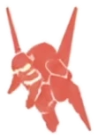

# 祁木良 · Bramble

**独立游戏制作人｜乌络游戏 Utoecho Games｜Vibe Coder｜AI 漫剧**

游戏 · 小说 · 剧本 · 影像 · 策划

点击上方终端，进入作品集

> [!NOTE]
> **个人便签**
>
> 个人进步是解决一切问题的最优解。

---

## 关于我

独立游戏制作人，AI 漫剧苦手，喜欢写小说和剧本，热爱文字。

- 游戏：Ren'Py / Unity，叙事、玩法原型与 Game Jam
- Vibe Coding：纯静态前端、离线优先、AI 接口集成
- AI 漫剧：ComfyUI + Krea2 + Seedance，角色一致性与镜头一致性管线
- 写作：短篇、同人、剧本与叙事诗，番茄小说签约作者

正在做：《世界终焉之时》——已上线 demo 的国产 galgame。

## 个人简历

游戏策划 / AI 漫剧制作 / 文职类 · 期望城市：上海

- 四次 Game Jam 完整项目开发经验，负责策划全流程并担任团队协调者
- 作为制作人主导 Galgame Demo 上线 Steam
- 精通 AI 漫剧全流程：ComfyUI + Krea2 + Blender + LibTV
- 独立开发多语言学习软件，接入 AI API
- 英语四级已过，法语 A1 在读，具备中医推拿技能

→ [查看完整个人简历](https://github.com/Brambleaaaaaa/portfolio/blob/main/resume/README.md)

## 三个入口

### 01 · Vibe Coding 产物

用 AI 辅助做出来的产品，按编号归档，新产物自动加入列表。

| # | 产品 | 介绍 | 入口 |
|---|---|---|---|
| 1 | **词刻 CIKE** | 本地优先的多语言词汇与阅读学习端，支持 8 种语言、离线与 AI 词典 | [仓库](https://github.com/Brambleaaaaaa/cike-multibook) · [在线体验](https://brambleaaaaaa.github.io/cike-multibook/) |

→ [进入 vibecoding 仓库](https://github.com/Brambleaaaaaa/vibecoding)

### 02 · AI 漫剧

一套完整的 AI 漫剧生产管线：角色资产、场景、道具、分镜、成片。

- 26 个 ComfyUI 工作流，统一 16:9 / Krea2 Turbo / 8GB 显存可跑
- 角色四视图 + 八/九表情 + 局部特写
- 场景多机位、白模深度控图、真机位环绕
- 分镜草图 → 逐格转 CG → Seedance 多资产合成

→ [进入 ai-manju 仓库](https://github.com/Brambleaaaaaa/ai-manju)

### 03 · 个人作品集

独立游戏、小说、剧本、影视与完整策划案。

| 分类 | 内容 |
|---|---|
| 独立游戏 | 世界终焉之时 Endfaryth / 罪船 / 已离开工位 / Correct Error / 通胀螺旋 / 货币牌 / 云汐 |
| 小说 | 短篇、中篇练笔、歌词、同人与练习稿、叙事诗 |
| 剧本 | 游戏剧本、跑团剧本 |
| 影视 | AI 漫剧管线、游戏影像、剪辑 |
| 音乐 | 约稿配乐、原创歌曲、个人曲目 |
| 策划案 | 云汐完整策划、他曾执意如此、罪船 |

→ [进入 portfolio 仓库](https://github.com/Brambleaaaaaa/portfolio)

## 代表作品

<table>
<tr>
<td width="50%">

 
<b>世界终焉之时 · Endfaryth</b> 
剧情向视觉小说 / JRPG · Steam Demo 
灰烬污染天空，暴雪吞噬世界。你从黑暗中醒来，寻找自己是谁。 
<a href="https://github.com/Brambleaaaaaa/portfolio/releases/tag/endfaryth-pv">宣传 PV（2'33"）</a>
</td>
<td width="50%">

 
<b>罪船 · The Evil Ship</b> 
叙事冒险 / 文字 AVG · Demo 
罪孽无法被宽恕的人，会被送上驶向迷雾的船。
</td>
</tr>
<tr>
<td width="50%">
<b>已离开工位</b> 
动作 · TapTap 聚光灯 Game Jam · 10.0 
熬夜加班之后，终于下定决心肘飞老板。 
<a href="https://tap.cn/lDNloJuU9">TapTap</a>
</td>
<td width="50%">
<b>Correct Error</b> 
反乌托邦 / 剧情 / 恐怖 · 9.1 
“自由即枷锁，知识即地狱。” 
<a href="https://tap.cn/lrdmk1ZrY">TapTap</a>
</td>
</tr>
</table>

## 音乐

个人项目与日常练习曲目。点击曲名可在浏览器中直接试听。

| # | 曲目 | 时长 | 试听 |
|---|---|---|---|
| 01 | Epiphany（立体声版本） | 1:21 | [播放](https://github.com/Brambleaaaaaa/portfolio/releases/download/music-v2/01_epiphany.mp3) |
| 02 | Evo | 2:02 | [播放](https://github.com/Brambleaaaaaa/portfolio/releases/download/music-v2/02_evo.mp3) |
| 03 | Lion | 1:25 | [播放](https://github.com/Brambleaaaaaa/portfolio/releases/download/music-v2/03_lion.mp3) |
| 04 | ørken | 2:02 | [播放](https://github.com/Brambleaaaaaa/portfolio/releases/download/music-v2/04_orken.mp3) |
| 05 | Rime | 3:26 | [播放](https://github.com/Brambleaaaaaa/portfolio/releases/download/music-v2/05_rime.mp3) |
| 06 | Voyage | 1:36 | [播放](https://github.com/Brambleaaaaaa/portfolio/releases/download/music-v2/06_voyage.mp3) |
| 07 | 淬青 | 0:57 | [播放](https://github.com/Brambleaaaaaa/portfolio/releases/download/music-v2/07_cuiqing.mp3) |
| 08 | 旌途 | 0:41 | [播放](https://github.com/Brambleaaaaaa/portfolio/releases/download/music-v2/08_jingtu.mp3) |

→ [全部曲目与约稿配乐](https://github.com/Brambleaaaaaa/portfolio/tree/main/music)

## 社媒

| 平台 | 账号 | 链接 |
|---|---|---|
| TapTap | 已离开工位 / 乌络游戏 | [tap.cn/lDNloJuU9](https://tap.cn/lDNloJuU9) |
| TapTap | Correct Error | [tap.cn/lrdmk1ZrY](https://tap.cn/lrdmk1ZrY) |
| 小黑盒 | 个人主页 | [user_profile_share](https://www.xiaoheihe.cn/bbs/user_profile_share?user_id=aa6369f22201&h_src=heyboxapp) |
| 小黑盒 | 世界终焉之时 | [游戏页](https://api.xiaoheihe.cn/game/share_game_detail?appid=3e1b69c30644&game_type=pc&h_camp=game&h_src=YXBwX3NoYXJl) |
| B 站 | 乌络游戏-祁木良 | [b23.tv/x1DKl5q](https://b23.tv/x1DKl5q) |
| 抖音 | 个人随笔（抖音号 61113198594） | [抖音搜索](https://www.douyin.com/search/61113198594?type=user) |
| 抖音 | 工作室宣传（抖音号 61690686111） | [抖音搜索](https://www.douyin.com/search/61690686111?type=user) |
| 抖音 | AI 漫剧号 | 建设中 |
| Steam | Endfaryth Demo | [app/5111560](https://store.steampowered.com/app/5111560/) |

---

**把想法做成能玩、能看、能上线的东西。**

&nbsp;&nbsp;

